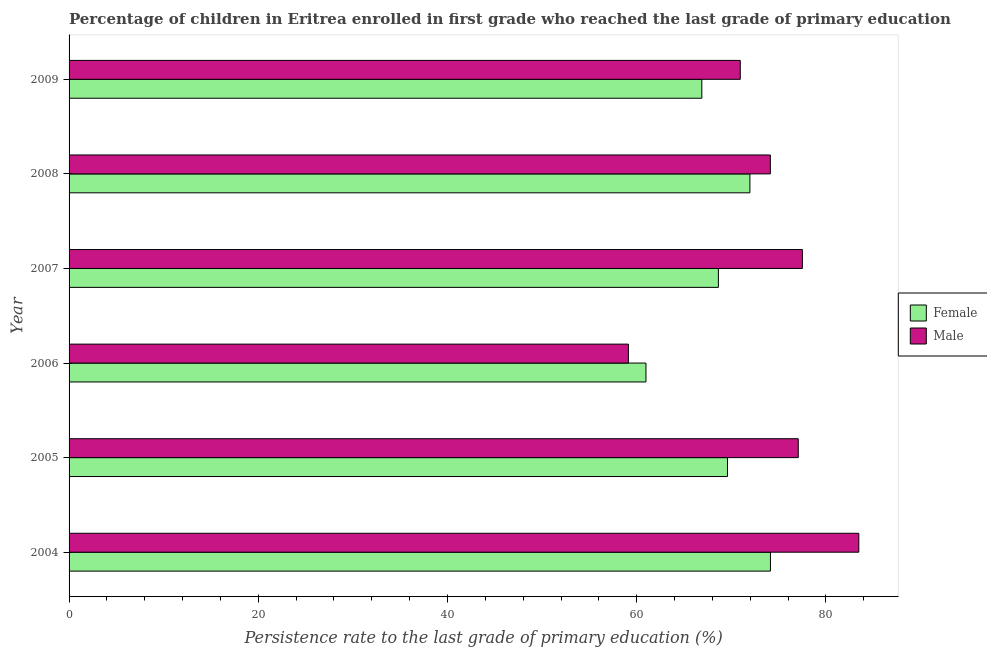
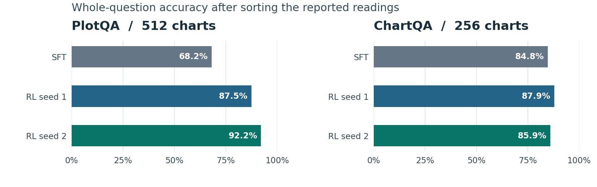

# Chart Evidence RL · 基于可验证读数的图表问答

**模型能把柱子从高到低排对，却未必能把每根柱子的数读准。** 这个项目让 Qwen3-VL 在同一张图上读取 3～6 个指定对象，用公开数据表逐项核对，再比较监督微调和强化学习能否提高读数精度。

在 512 道 PlotQA 派生测试题上，统一程序排序后，多对象监督微调答对 **349 道**，两个强化学习种子分别答对 **448 和 472 道**。换到 256 道 ChartQA 派生题，净增缩小到 **8 和 3 道**。

[真实例题](#真实例题) · [测试结果](#测试结果) · [CPU 复算](#cpu-复算) · [训练方法](#训练方法) · [简历表述](docs/resume.md)

> **快速复算**　下载仓库后，在根目录运行 `python evaluate.py`。Python 3.10+，仅用 CPU。

## 真实例题

**看下图的 Female 系列。2006、2004、2005 年分别是多少？请按数值从大到小排列。** 图中横轴是百分比。绿色横条代表 Female，紫色代表 Male。题目根据 PlotQA 测试图 6691 和原表生成，喂给模型的是英文题面。



| 回答来源 | 2004（%） | 2005（%） | 2006（%） | 给出的降序 | 整题 |
|---|---:|---:|---:|---|---|
| 公开数据表（显示三位小数） | 74.134 | 69.594 | 60.978 | 2004 › 2005 › 2006 | 参考 |
| 多对象监督微调 | 74 | 70 | **62** | 2004 › 2005 › 2006 | 2/3 个数正确 |
| 80/10/10 · 种子 1 | 74 | 70 | **61** | 2004 › 2005 › 2006 | 全对 |
| 80/10/10 · 种子 2 | 74 | 70 | **61** | 2004 › 2005 › 2006 | 全对 |


三个模型给出了相同的顺序。按图轴预先确定的刻度分辨率，这道题允许每个读数相差 1 个百分点。2006 年的上限约为 **61.978%**，所以 **62%** 超出上限约 0.022 个百分点，**61%** 在范围内。这也是一个边界案例，判断整体效果要看下面的完整测试集。[英文原题、完整回答与精确容差](docs/example.json)

## 测试结果



**PlotQA · 512 张图，2,304 个读数**

| 模型 | 读对的数 | 直接全对 | 重排全对 | 净增¹ |
|---|---:|---:|---:|---:|
| 监督微调 | 2,106 | 345 | 349 | — |
| RL 种子 1 | 2,230 | 433 | 448 | **+99** |
| RL 种子 2 | 2,253 | 459 | 472 | **+123** |

**ChartQA · 256 张图，1,152 个读数**

| 模型 | 读对的数 | 直接全对 | 重排全对 | 净增¹ |
|---|---:|---:|---:|---:|
| 监督微调 | 1,087 | 138 | 217 | — |
| RL 种子 1 | 1,097 | 141 | 225 | **+8** |
| RL 种子 2 | 1,094 | 138 | 220 | **+3** |

¹ 相对同一题单上也经过程序排序的监督微调模型。每列的三个模型都回答同一批题，两个种子分别报告。 两次 GRPO 都从表中的多对象监督微调模型出发，使用同一个综合奖励。

**直接作答**要求每个指定对象的读数都在容差内，且模型给出的完整顺序正确。**程序排序**保留模型写出的读数，仅按数值降序重排题目指定的对象。缺少可比较的读数、读数冲突或无法解析时沿用原排序。排序过程只接触题目和预测；标准答案用于随后评分。

**跨数据集观察。** 在 PlotQA 的 163 道监督微调错题中，158 道的错误全部是较小的数值偏差（已越界，但与标准值的距离不超过容差半宽的两倍）。ChartQA 的 39 道错题中，这类题只有 12 道，另有 13 道缺少至少一个指定对象。这批题说明了同来源读数精度的改善，也显示出跨来源提升的局限。这些分数来自项目筛选的柱状图及其派生问题，适用范围与官方全量问答榜单不同。

## CPU 复算

在仓库根目录，用 **Python 3.10 或更新版本**执行：

```bash
python evaluate.py
```

只用 Python 标准库，无需安装依赖、下载模型或连接网络。程序解压随仓库提供的 768 道题、原始回答和数值区间，重新解析三个模型的 **2,304 份回答**，逐项计分后打印上表。最后与归档计数交叉核对，任何一项不一致都会报错。[评分代码](chart_eval/) · [逐题数据及字段说明](data/README.md)

## 训练方法

**监督微调。** 从已有双对象 LoRA 权重出发，在 8,000 张 PlotQA 图上学习输出 3～6 个对象的读数及顺序。

**强化学习。** 两次都从同一个多对象监督微调模型出发。在 256 道训练题上，每题采样 4 次，每个种子更新 64 步。奖励的 **80%** 看逐项读数、**10%** 看成对顺序、**10%** 看整题全对。

**测试。** 三个模型使用相同提示和贪心解码；每个对象数档在 PlotQA 有 128 张图，在 ChartQA 有 64 张图。[训练代码与环境](training/README.md) · [奖励函数](training/reward.py) · [实验配置](training/protocol.json)

## 数据与参考实现

示例图片来自 PlotQA。训练和评测题由项目基于公开图表和源数据表派生。基础模型为 Qwen3-VL-2B-Instruct，实验参考 vqa-rlvr 的训练实现。版本和来源见[数据说明](data/README.md)。[PlotQA](https://github.com/NiteshMethani/PlotQA) · [ChartQA](https://github.com/vis-nlp/ChartQA) · [Qwen3-VL](https://huggingface.co/Qwen/Qwen3-VL-2B-Instruct) · [vqa-rlvr](https://github.com/guangboyu/vqa-rlvr/tree/88f4f5d4c96c139bf0be7fc9d54726a81ac6620f)
