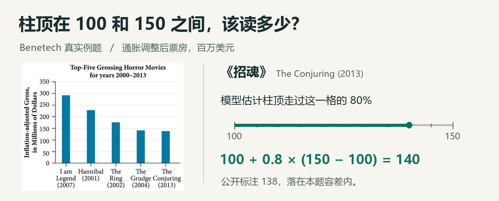
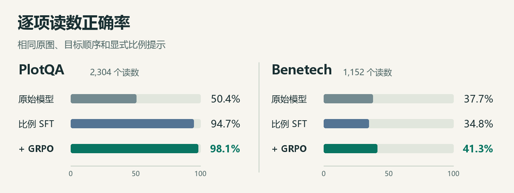
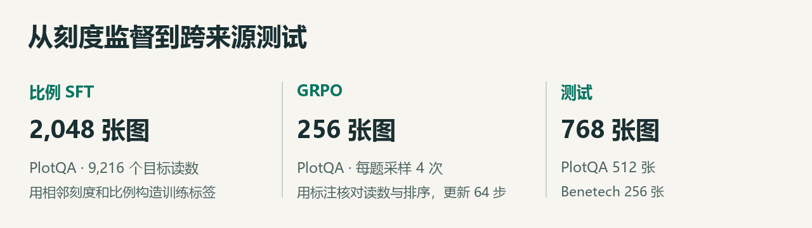

<h1 align="center">Chart Evidence RL</h1>

<p align="center"><strong>让视觉模型对照刻度，估读柱状图</strong></p>
<p align="center"><a href="#example">真实例题</a>　·　<a href="#results">测试成绩</a>　·　<a href="#method">训练方法</a>　·　<a href="#replay">CPU 复算</a></p>

给 Qwen3-VL-2B-Instruct 一张图，指定 3～6 根柱子。模型要为每根柱子写出**上下刻度、柱顶在这一格中的比例和估计读数**，再把目标从高到低排序。我们用公开图表标注构造训练答案，也用它逐项核对模型的回答。

<a id="example"></a>



图中《招魂》的参考票房为 **138 百万美元**，本题接受区间是 **[133, 143]**。在同一张图上，原始模型和 GRPO 都读成 140，比例 SFT 读成 125。核对题目指定的四部电影后，三组分别读对 **2、2、3** 个数。

<details>
<summary><strong>展开四部电影的读数对照</strong></summary>

| 目标电影 | 参考值 | 原始模型 | 比例 SFT | 比例 SFT + GRPO |
|---|---:|---:|---:|---:|
| The Conjuring | 138 | 140 ✓ | 125 | 140 ✓ |
| I Am Legend | 293 | 280 | 287.5 | 287.5 |
| Hannibal | 228 | 220 | 230 ✓ | 225 ✓ |
| The Ring | 175 | 180 ✓ | 175 ✓ | 175 ✓ |

✓ 表示该读数在图轴容差内。三个模型对《我是传奇》的估计均超出容差，因此这道题都未获整题分。[查看原始图像](assets/ratio/benetech-example.jpg) · [查看三份回答与逐项目标区间](ratio_eval/example.json)

</details>

<a id="results"></a>

## 在另一种来源的图上，还能读得更准吗？

**在显式比例提示下，GRPO 在 Benetech 上比比例 SFT 多读对 75 个数，比原始模型多读对 42 个数。** 三组均使用相同的原图、目标顺序和贪心解码。PlotQA 测试图与训练图同来源；Benetech 的目标柱旁没有直接标数，需要对照坐标轴估读。



| 测试集 | 模型 | 读对的数 | 直接整题全对 |
|---|---|---:|---:|
| PlotQA | 原始模型 | 1,162 / 2,304（50.4%） | 0 / 512（0.0%） |
| PlotQA | 比例 SFT | 2,181 / 2,304（94.7%） | 378 / 512（73.8%） |
| PlotQA | **比例 SFT + GRPO** | **2,261 / 2,304（98.1%）** | **436 / 512（85.2%）** |
| Benetech | 原始模型 | 434 / 1,152（37.7%） | 6 / 256（2.3%） |
| Benetech | 比例 SFT | 401 / 1,152（34.8%） | 27 / 256（10.5%） |
| Benetech | **比例 SFT + GRPO** | **476 / 1,152（41.3%）** | **31 / 256（12.1%）** |

**读对一个数**要求类别匹配且数值落在预先固定的区间。**直接整题全对**还要求全部目标读数正确，且模型自己输出的排序正确。原始模型在部分题上重复输出刻度或未给出符合要求的排序，整题成绩也受输出格式影响。

<details>
<summary><strong>置信区间与评测范围</strong></summary>

Benetech 上，GRPO 相对比例 SFT 的逐项正确率提高 **6.51 个百分点**（95% 区间 **+3.65 至 +9.38**），相对原始模型提高 **3.65 个百分点**（**+0.26 至 +7.03**）。按目标数量分层，以图为单位配对重抽 10,000 次。

本轮使用一个训练种子。测试图曾用于项目历史评测，Benetech 相对于训练集是外部留出集。上表结论限定于要求写出刻度和比例的提示。评分依据最终读数和排序；模型写出的比例和读数有时并不一致。[查看算术一致性核验](ratio_eval/arithmetic.json)

</details>

<a id="method"></a>

## 模型怎样学会估读？



**第一步，用刻度构造监督答案。** 从原始 Instruct 模型新建 LoRA。按图轴分辨率，把一个主刻度间隔分成 10 或 20 份，由公开标注生成“下刻度、上刻度、区间内比例、估计值”。例如下刻度 60、上刻度 80、比例 0.95，对应的训练读数是 **79**。

**第二步，用图表标注给回答打分。** 从比例 SFT 权重出发，每题采样 4 次。GRPO 奖励由 **80% 逐项读数、10% 两两顺序、10% 整题全对**组成，固定更新 64 步。比例字段在 SFT 中有监督，GRPO 按最终读数和排序给奖励。[查看训练配置与完整提示词](ratio_eval/plan.json)

| 用途 | 图像来源 | 规模 |
|---|---|---|
| 比例 SFT | PlotQA 训练集 | 2,048 张，3～6 个目标各 512 张，共 9,216 个读数 |
| GRPO | PlotQA 训练集，另取图像 | 256 张，共 1,024 份采样回答 |
| 验证 | PlotQA | 768 张，仅用于评测 |
| 同来源测试 | PlotQA | 512 张，2,304 个读数 |
| 跨来源测试 | Benetech 外部留出集 | 256 张，1,152 个读数 |

<a id="replay"></a>

## 一条命令复算主表

在仓库根目录运行，需要 **Python 3.10+**，仅使用标准库。

```bash
python ratio_eval/replay.py
```

脚本从 **2,304 份已保存的原始回答**（768 张测试图 × 3 个模型）重新解析读数和排序，逐项比对参考区间，并核验上表六行成绩。[PlotQA 回答与参考值](ratio_eval/plotqa.jsonl.gz) · [Benetech 回答与参考值](ratio_eval/benetech.jsonl.gz) · [汇总记录](ratio_eval/summary.json)

图表与基座模型来源：[PlotQA](https://github.com/NiteshMethani/PlotQA) · [Benetech Making Graphs Accessible](https://www.kaggle.com/competitions/benetech-making-graphs-accessible/data) · [Qwen3-VL-2B-Instruct](https://huggingface.co/Qwen/Qwen3-VL-2B-Instruct)
